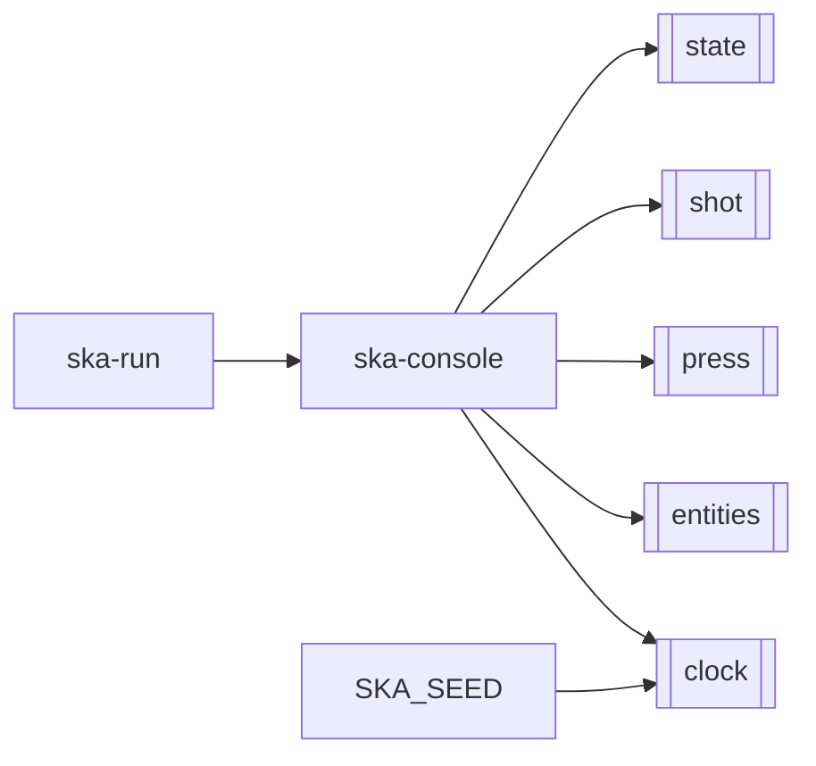
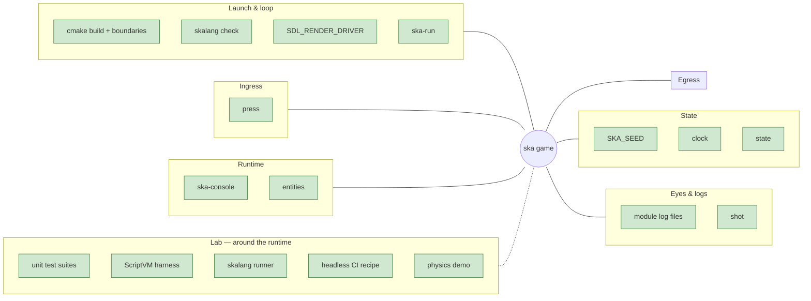

# Agent map — ska engine @ 219a9d9d (2026-11-23)

## Contents
- Parallel agents
- Tools already in place
- Capabilities
- Delivered handles
- Candidate handles (not built)
- Deferred handles
- Roadmap
- Transferable patterns
- Rules → guards
- Fences to set first
- Diagram
- Points
- Classes with no point
- Unknowns
- Decisions
- Revisions
- Accepted plan
- Grill
- Noticed in passing

**Shape(s):** game engine (2D, SDL3, ECS) + embedded scripting host (skalang) · **Repos covered:** ska (`external/ska` in Smash & Dash; skabase, skalog, skalang (folders of ska) read for evidence) · **Mapped by:** Claude (toolsmith map), not grilled yet

**Variants:**
- native (Linux, Windows build script `build_vs2019_win32.bat`): `ska_main` loads the game library, a `for(;;)` loop calls `GameCore::frame` (`ska_core/src/src/Core/GameCore.h:61`).
- web (Emscripten, `cmake/SkaWeb.cmake`): no thread, the browser calls `frame` (`ska_core/src/src/Core/GameCore.h:48`), no socket; the page reaches the module through JS (`-sEXPORTED_RUNTIME_METHODS=FS,IDBFS,ENV,…`, `cmake/SkaWeb.cmake:78`).
- renderer: SDL3 `gpu` driver (shaders) or any other one (`SDL_RENDER_DRIVER`, `ska_draw/src/src/Graphic/SDLRenderer.cpp:34`); on Xvfb the `gpu` driver runs on lavapipe (`.github/workflows/linux.yml`).

**In one paragraph:** the engine is well tooled *outside* the live process — a CMake build that checks module boundaries and scripts, six doctest suites, a headless CI recipe (Xvfb + lavapipe + dummy audio), a static checker and a standalone runner for skalang. *Inside* a running game an agent has nothing: no argument, no console, no screenshot, no input it can inject, a wall clock and three randomly seeded generators, logs written over the human's files in the working folder, and an uncaught error that opens a modal box and waits for a click. The capabilities that would change that most: **run a game unattended in its own run folder** (launch, ready, stop, logs), **reach into the live loop** through one primitive — a console drained by `GameCore::frame`, so every game and both variants get it — and **see and replay** a named state (framebuffer shot, seeds, a steppable clock).

## Parallel agents

**Agents that can safely work at once today: 1 running a game** (any number building and running the unit tests in their own worktrees) — a second run overwrites the first one's logs in the working folder, and every run opens its window and its sound on the human's session.

| Shared resource | Shared by | What collides | Isolation today | Proposal (level 1 · 2 · 3) |
|---|---|---|---|---|
| log files `*.log.txt` in the working folder (12 module loggers, e.g. `ska_core/src/src/Core/__internalConfig/LoggerConfig.cpp:5`, `ska_main/src/src/Main/__internalConfig/LoggerConfig.cpp:5`) | every run started from the same folder (Smash & Dash runs from its repository root) | `std::ofstream{filename}` truncates: the second run erases the first one's logs, both interleave | none | level 2: `SKA_LOG_DIR` (Needs of `ska-run`), one folder per run |
| display (X/Wayland of the human) | every run | windows pop on the human's screen, take the focus, the input of the human goes to the agent's game | none (CI uses `xvfb-run -a`) | level 2: `ska-run` starts one Xvfb per run (`xvfb-run -a` picks a free display) |
| audio device | every run | the agent's game plays on the human's speakers | none (CI sets `SDL_AUDIO_DRIVER=dummy`) | level 2: `ska-run` sets `SDL_AUDIO_DRIVER=dummy` unless `--audio` |
| `build/` tree of the checkout (`bin/std` deployed scripts, `lib/`) | agents building in the same checkout | concurrent `cmake --build` in one tree | per worktree (each has its own `build/`) | none needed: one build tree per worktree |
| console endpoint (proposed) | every run with the console | two runs on one port/path | — | level 2: a Unix socket path inside the run folder |

## Tools already in place

| Tool | Category | Verb | Way | Point(s) | Usage |
|---|---|---|---|---|---|
| CMake build + boundary check | launch | check | witness | B11, B4 | `cmake -S . -B build && cmake --build build -j8` (fails on a module boundary violation: `cmake/CheckBoundaries.cmake`) |
| unit test suites (doctest) | lab | check | bring out | B3, B4, B5 | `build/bin/ska_core_test && build/bin/ska_scripting_test` (also `ska_ai_test`, `ska_gui_test`, `ska_particle_test`, `ska_world_test`; from the repository root; `xvfb-run` without a display — `CLAUDE.md`) |
| `ScriptVM` test harness | lab | steer, check | bring out | B3, B4 | `ska_scripting/test/src/ScriptVM_test.cpp` — 15 test cases running scripts, waits, hooks, calls without a game |
| skalang static check | launch | check | witness | B4, B11 | `skalang_check_scripts(...)` (skalang `cmake/SkalangCheck.cmake`), binary `skalang_check --bind <dir> --wd <dir>` (`external/skalang/bytecode/checker/src/main.cpp:96`) |
| skalang runner | lab | steer | bring out | B3 | `skalang_bytecode_runner <script.miniska> args…` (`external/skalang/bytecode/runner/src/main.cpp:30`) — runs a script outside any game, without the engine modules |
| headless CI recipe | lab | — | bring out | B10 | `.github/workflows/linux.yml`: Ubuntu 26.04 container, `xvfb-run -a`, `SDL_AUDIO_DRIVER=dummy`, lavapipe for the `gpu` renderer |
| framebuffer readback in a test | eyes | see | bring out | B1 | `ska_gui/test/src/Shader_test.cpp:15` `sdl.readPixels(*renderer.unwrap(), &rect)` — only inside a test |
| `SDL_RENDER_DRIVER` | launch | steer | reach in | B13, B10 | `SDL_RENDER_DRIVER=opengl build/bin/ska_main` (`ska_draw/src/src/Graphic/SDLRenderer.cpp:34`) |
| module log files | eyes | see | witness | B12 | `tail -n 50 Main.log.txt` in the working folder (12 files, Debug level, also on stdout: `ska_main/src/src/Main/__internalConfig/LoggerConfig.cpp:11`) |
| SDL3 deps for the web | launch | — | — | B11 | `tools/web/build_deps.sh <prefix>` |
| desktop physics demo | lab | see | bring out | B3 | `build/bin/ska_physic_simulation_chipmunk` (`ska_physic_chipmunk/CMakeLists.txt:5`) — a second consumer of `GameCore`, in the engine repo |

## Capabilities

| # | Capability — the agent can… | Today | Evidence |
|---|---|---|---|
| C1 | run any ska game unattended in its own run: launch it without a screen, know it is ready, stop it cleanly, read its logs | a human launches it on their display; logs overwrite the human's in the working folder; an uncaught error waits on a modal box; the only exit is the window's close button | `ska_main/src/src/Main/main.cpp:10` ignores `argv`; `ska_core/src/src/Core/GameCore.h:61` `for (;;)`; exit only through `SDL_EVENT_QUIT` (`ska_core/src/src/Core/Inputs/RawInputListener.cpp:87`); 12 truncating log files in the CWD; `ska_gui/src/src/GUI/MessagePopup.cpp:27` |
| C2 | look and act inside the live game: run skalang in it, read the scene and the entities, press keys | nothing: scripts start only from map events, tiles and hooks; consumers add env flags one by one (Smash & Dash `SAD_BATTLE_AUTOPLAY`, `SAD_BATTLE_PASSIVE`) | B3 no console; `ska_scripting/src/src/Scripting/ScriptVM.h:68` `start` and `:89` `call` exist in process only; B1 input only from `SDLLibrary::pollEvent` (`ska_core/src/src/Core/Inputs/RawInputListener.cpp:33`) |
| C3 | see a named state: a screenshot of the frame, with the state it shows | a human looks at the window | `SDL_RenderReadPixels` bound (`ska_core/src/src/Core/SDLLibrary.h:275`) but used only by `ska_gui/test/src/Shader_test.cpp:15` |
| C4 | replay a run exactly: the same random draws and the same frames | three generators seeded from `random_device`, the frame time from the wall clock | `external/skabase/src/src/Base/Values/Numbers/NumberUtils.cpp:12`, `ska_scripting/src/src/Scripting/EngineModule.cpp:27`; `ska_core/src/src/Core/Utils/TimeUtils.cpp:7` `SDL_GetTicks` |

## Delivered handles

### `ska-run` — launch (+ lab) · B2 Process · steer, see · reach in · cost M
**Status:** delivered
**Finishes:** the CI recipe (`.github/workflows/linux.yml`: `xvfb-run -a`, `SDL_AUDIO_DRIVER=dummy`) — turned into a command any game can use

```sh
$ tools/ska-run up a1 --cwd ../.. --ready eval --env LD_LIBRARY_PATH=$PWD/../../build/lib -- ../../build/bin/ska_main
{"run": "a1", "pid": 1142201, "display": ":2", "console": "/tmp/ska-runs-1000/a1/console.sock", "logs": "/tmp/ska-runs-1000/a1/logs", "state": "WorldState > StateMap, StateGUIMap", "ready_ms": 270}
$ tools/ska-run logs a1 --grep "Battle t=" --strip --tail 1
Game.log.txt: [Debug](BattleSystem l.0143) Battle t=3020 : player at 784, 540 distance 72 px, decision -1, movement 3
$ tools/ska-run down a1
{"run": "a1", "exit": 0, "stopped_by": "console quit"}
```

**Is:** `tools/ska-run` (Python 3, stdlib): a run folder per id (`/tmp/ska-runs-<uid>/<id>`), its own Xvfb (`-displayfd`, a free display), dummy audio, `SKA_CONSOLE`, `SKA_LOG_DIR`, `SKA_HEADLESS`; `--env`, `--copy`, `--seed`, `--fixed-step`, `--pause-at`; ready when the console answers (`--ready eval` : when it runs skalang); `down` through the console's `quit`, then SIGTERM; the exit code kept by a wrapper shell; `ps`, `logs --grep --tail --strip`, `path`, `rm`. Engine side: `ska::LogFilePath`/`OpenLogFile` (skabase, the 15 log files of the engine, skalang and the game; unbuffered in a run), `SKA_HEADLESS` in `SDLLibrary::showSimpleMessageBox`.
**Gives the agent:** a game running unattended, isolated from the human's screen, sound and logs, with a known end and exit code.
**Not a script because:** it runs before the primitive exists in the process (launch, per-run folder) and must work when the loop is dead (`down`, `logs`).
**Origin:** map
**Fence:** nothing on the human's display unless `--display`; signals only the processes of its registry.
**Parallel:** one folder, display and socket per run id — two runs side by side were used for the replay demo (`:2`, `:3`).
**Permission:** allow (`.claude/settings.json`).
**Verified:** demoed — 2026-11-23, Smash & Dash under it: up, logs, down with exit 0, a game error reported with its exit code (134) and the tail of its output; in `tools/doctor` (Smash & Dash CI). The engine's physics demos too, from the repository root: `tools/ska-run up demo -- build/bin/ska_physic_simulation_chipmunk` (ping, shot, press, down with exit 0).

### `ska-console` — runtime (+ ingress) · B3 Runtime · steer, see · reach in · cost M
**Status:** delivered
**Finishes:** `ScriptVM::start` / `call` (in process only) and the per-frame safe point `GameCore::frame`

```sh
$ tools/ska-console --run a1 eval 'Engine.variable("%00012") + 1'
{"ok": true, "value": "1", "frames": 0}
$ tools/ska-console --run a1 eval 'Engine.wait(500)'
{"ok": true, "value": "", "frames": 24}
$ tools/ska-console --run a1 eval 'Nope.call()'
{"ok": false, "error": "does not compile : in \"…/eval/eval_4.miniska\"\n\t(l.1, c.6) Symbol not found : Nope", "frames": 0}
$ tools/ska-console --run a1 run tools/agent/entities.miniska trainer
{"ok": true, "value": "#0 \"trainer\" at (576,384) components: PositionComponent … InputComponent …", "frames": 0}
$ tools/ska-console --run a1 shot town
{"ok": true, "value": "/tmp/ska-runs-1000/a1/shots/town.png", "w": 1120, "h": 640, "state": "WorldState > StateGUIMap, StateMap", "step": 38, "frames": 1}
```

**Is:** (1) `ska_core` `Core/Dev/DevConsole`: a non-blocking Unix socket polled at the top of `GameCore::frame` (no thread, no script step running), one request per connection, JSON answers; built-in verbs `ping`, `quit`, `shot` (read back in `SDLRenderer::update` before present, `IMG_SavePNG`), `press` (merged in `RawInputListener::update`), `pause`/`resume`/`step` (`TimeUtils` virtual clock); a `DevConsoleEvaluator` interface; (2) `ska_scripting`: `ScriptVM` is the evaluator — `eval` (one line : an expression, its value as text; else statements; a prelude of imports: `Engine`, `Dev`, and what the game adds with `addConsolePrelude`), `run <file>`, answered when the script ends (`ScriptVM::start(…, EndCallback)`), errors with the lines of the code sent; `bind:ska.dev` (`reply`, `steps`, `states`, `shot`, `press`, `pause`, `resume`, `paused`, `step`); `Engine.describe`, `Engine.variables`; (3) `tools/ska-console` (Python 3): `--run` (else the only run alive), `eval -` (stdin), `--raw`, `scripts`.
**Gives the agent:** any state of any ska game, read or changed through the game's own script verbs, plus eyes, input and the clock.
**Not a script because:** it is the primitive.
**Origin:** map
**Fence:** compiled in the native builds (`SKA_DEV_CONSOLE`, OFF on the web, `-DSKA_DEV_CONSOLE=OFF` for a shipped build — decision revised, see Decisions), opened only when `SKA_CONSOLE` is set, a Unix socket created with umask 0077, never TCP.
**Parallel:** one socket per run; several connections served at once (a `press` while a `run` waits).
**Permission:** allow.

| Script | Usage → prints | Needs |
|---|---|---|
| `state` | `ska-console run tools/agent/state.miniska` → `states=WorldState > StateMap, StateGUIMap\nstep=12\npaused=false` | delivered (`Dev.states`, `Dev.steps`) |
| `entities` | `… run tools/agent/entities.miniska trainer nobody` → `#0 "trainer" at (672,480) components: …\nnobody : not found` | delivered (`Engine.describe`, `EntityManager::componentNames`, `EntityLocator::getName`) |
| `shot` | `ska-console shot <name>` → `{"path":…,"w":1120,"h":640,"state":…}` | delivered as a console verb (and `Dev.shot` for scripts) |
| `press` | `ska-console press Return 2` → `{"value":"pressed","frames":2}` | delivered as a console verb (`DevConsole::press`, `SDL_GetScancodeFromName`) |
| `clock` | `ska-console pause`, `step 10` → `{"value":"step 582","frames":10}`, `resume` | delivered (`TimeUtils::freeze/advance`, `SKA_FIXED_STEP`, `SKA_PAUSE_AT`) |
| `quit` | `ska-console quit` → the process exits 0 | delivered |

**Verified:** demoed — 2026-11-23 on Smash & Dash (every row above ran; `tools/doctor`: 18 checks pass); tested — 4 new `ska_scripting_test` cases (eval value, eval that waits, errors, `run` + `Dev.reply`), the 6 ska suites pass on a standalone build.

### `SKA_SEED` — state · B8 Time & chance · freeze · reach in · cost S
**Status:** delivered
**Finishes:** **New**

```sh
$ tools/ska-run up r1 --seed 7 --fixed-step --pause-at 120 … && tools/ska-run up r2 --seed 7 --fixed-step --pause-at 120 …
$ ska-console --run r1 shot same && ska-console --run r2 shot same && cmp r1/shots/same.png r2/shots/same.png   # exit 0
$ tools/ska-run logs r1 --grep "Random seed"
stdout.log: [Info ](DevConsole.c l.0137) Random seed : 544882316 (picked : SKA_SEED=544882316 replays it)
```

**Is:** skabase `NumberUtils`: its generator seeded from `SKA_SEED` (else a picked seed, logged); `NumberUtils::seed()`, `newSeed()` for the other generators (`EngineModule` `Engine.random`; the game's own); with `SKA_FIXED_STEP` (one logic step per frame, virtual clock) and `SKA_PAUSE_AT` (the game pauses itself at a step) a run replays.
**Gives the agent:** the same random draws and the same frames on every run.
**Not a script because:** the generators are seeded before the console exists.
**Origin:** map
**Fence:** none needed.
**Parallel:** per process.
**Permission:** allow.
**Verified:** demoed — 2026-11-23: two runs `--seed 7 --fixed-step --pause-at 300`: frames byte-identical at step 300 and after 200 more steps; Smash & Dash battle traces identical (968 lines). A seed-8 run gives another battle trace; its frame at step 500 is identical to seed 7 because nothing random is drawn on that screen.

## Candidate handles (not built)

(none : the three proposed cards are delivered; the deferred ones below)

## Deferred handles

### `web console` — runtime (+ ingress) · B3 Runtime · steer, see · reach in · cost M
**Status:** deferred
**Deferred because:** the native console proves the evaluator first; the web transport is a second transport on the same `DevConsole`.
**Revisit when:** `ska-console` is delivered, or a task needs the web build (Smash & Dash `feat/web`).

```sh
$ tools/ska-web-console --url http://127.0.0.1:8000 eval 'Engine.variable("story.step")'
{"ok":true,"value":3,"frames":1}
```

### `frozen shot` — eyes · B1 Human UI · see · witness · cost S
**Status:** deferred
**Deferred because:** needs a hung game to matter; `shot` covers every live state.
**Revisit when:** a task meets a frozen loop.

```sh
$ tools/ska-run shot a1 --outside
{"path":"/tmp/ska-runs/a1/shots/outside-001.png","source":"xwd :99"}
```

## Roadmap

**Foundations**

| Foundation | Used by | Unlocks | Cost |
|---|---|---|---|
| `ska-console` (the primitive) | `ska-run` (ready, quit), scripts `state`, `entities`, `shot`, `press`, `clock`, `quit` | runtime + ingress + eyes for every ska game, both variants later | M |
| `ska-run` (per-run folder) | every run of every handle | parallel agents; nothing on the human's screen or logs | M |



### M1 — walking skeleton · keystone
**Capability:** C1 — run any ska game unattended in its own run.
**Status:** delivered
**Builds:** `ska-run`, `ska-console`, scripts `state`, `shot`, `quit`.
**Depends on:** none.
**Demo:** `tools/ska-run up a1 --cwd ../.. -- build/bin/ska_main && tools/ska-console --run a1 run tools/agent/state.miniska && tools/ska-console --run a1 run tools/agent/shot.miniska title && tools/ska-run down a1`
**Expect:** `state` prints the current state name and an entity count as JSON; `/tmp/ska-runs/a1/shots/title.png` shows the game's first screen; `down` prints `"exit":0`; nothing appeared on the human's display and no `*.log.txt` in the working folder changed.
**Why first:** every later script runs through these two.
**Verified:** demoed — 2026-11-23 on Smash & Dash: `state` printed the states and the step, `shot` showed the start map, `down` printed `"exit": 0`; nothing on the human's display, the logs in the run folder.

### M2 — act inside the live game
**Capability:** C2 — look and act inside the live game.
**Status:** delivered
**Builds:** scripts `entities`, `press`.
**Depends on:** M1 — the console runs the scripts.
**Demo:** `tools/ska-console --run a1 eval 'Dev.press("Return", 3)' && tools/ska-console --run a1 run tools/agent/state.miniska`
**Expect:** the state name changes after the key (Smash & Dash: the title screen gives way to the map), and `entities trainer` prints a position.
**Verified:** demoed — 2026-11-23: Smash & Dash has no title screen (it starts on the map); `press Return` closed a battle message (the injected key reaches the GUI), `entities trainer` printed its position and components.

### M3 — replay a run
**Capability:** C4 — replay a run exactly.
**Status:** delivered
**Builds:** `SKA_SEED`, script `clock`.
**Depends on:** M1 — the `clock` script runs through the console.
**Demo:** two runs `up r1 --seed 7` and `up r2 --seed 7`, each `eval 'Dev.pause()'`, the same `press` and `eval 'Dev.step(120)'`, then `shot` in both.
**Expect:** the two PNGs are byte-identical (`cmp` exits 0); with `--seed 8` they differ wherever the scene draws random things (particles, camera shake).
**Verified:** demoed — 2026-11-23: `cmp` exit 0 at step 300 and step 500 (`--pause-at` replaced the `Dev.pause()` of the demo: the pause must fall on the same step); the seed-8 frame did not differ (nothing random on that screen) — the difference shows in the battle traces of Smash & Dash M3.

### Deferred
- `web console` — after the native console; the same evaluator, a JS transport.
- `frozen shot` — when a frozen loop shows up.
- C3 is delivered by M1 (`shot`); its deeper step (shot of a frozen loop) is `frozen shot`.

## Transferable patterns

| Pattern | Does | Evidence here | Fits when | Does not fit when | Here as |
|---|---|---|---|---|---|
| console drained at the engine's frame | one live-eval primitive for every game on the engine, hosted where every host already calls in each frame, on the thread and at the point where running code is safe | `GameCore::frame` is the only per-frame entry for native and web (`ska_core/src/src/Core/GameCore.h:48`, `:61`) | the engine owns or is called by a per-frame function on the main thread | the engine is a set of free functions the host calls in no fixed order | `ska-console` |
| replies after the script's own wait | a console request that answers when the scripted action is over, not when it was queued | scripts already suspend and resume on completion (`ska_scripting/src/src/Scripting/ScriptVM.h:122`) | the embedded language has coroutines or suspension | scripts run to completion synchronously | `ska-console` (`eval 'Engine.wait(500)'` → `frames: 31`) |

## Rules → guards

| Rule (where) | Guard | Kind |
|---|---|---|
| "Rerun `cmake -S . -B build` after adding a source file (the sources are globbed)" (`CLAUDE.md`, Build and tests) | post-tool hook: on a new `.cpp`/`.h` under `ska_*/src`, rerun the configure step (or remind) | hook |
| "The engine modules know nothing about the scripting" (`CLAUDE.md`, Boundaries) | already enforced: `cmake/CheckBoundaries.cmake` at each build | CI (in place) |
| "never give a raw `EntityId` to a script, never use an `int` from a script as an `EntityId` without `handles.entity(...)`" (`CLAUDE.md`, Scripting) | grep check in the build: `NodeValue{ … EntityId …}` / `static_cast<EntityId>` in `ska_scripting` and game modules outside `EntityHandles` | lint |
| "Update the template with the C++ binding" (`CLAUDE.md`, Scripting) | already enforced for the scripts (`skalang_check_scripts`); a check that every `bindField("x")` has `x =` in the template would close it | lint |
| "Run the tests from the repository root" (`CLAUDE.md`, Build and tests) | `ctest` entries with `WORKING_DIRECTORY` set (the suites are plain executables today) | CI |

## Fences to set first

| ⚠ | Fence | Evidence | Why it matters to an agent |
|---|---|---|---|
| 1 | a launched game writes its logs over the human's | 12 `std::ofstream{ "<Module>.log.txt" }` in the CWD, e.g. `ska_main/src/src/Main/__internalConfig/LoggerConfig.cpp:5` | any agent run truncates the logs the human is reading; `SKA_LOG_DIR` before any agent launches a game |
| 2 | an uncaught error blocks on a modal box | `ska_gui/src/src/GUI/MessagePopup.cpp:27` (a game calls it in `onException`) | an unattended run hangs forever on a box nobody sees; `SKA_HEADLESS` makes it log and return |

## Diagram



## Points

- **B1 Human UI** — window · `ska_draw/src/src/Graphic/SDLWindow.cpp:24` (created hidden, then shown) · see ✗ (readback only in `ska_gui/test/src/Shader_test.cpp:15`) · steer human · loop: one window per process
- **B1 Human UI** — input · `ska_core/src/src/Core/Inputs/RawInputListener.cpp:33` `pollEvent` loop → key/mouse states → input contexts (`ska_core/src/src/Core/Inputs/KeyboardInputContext.cpp:20`) · steer ✗ no injection · see ✗
- **B1 Human UI** — modal error box · `ska_gui/src/src/GUI/MessagePopup.cpp:27`, `ska_draw/src/src/Graphic/SDLWindow.cpp:50` · blocks an unattended run (Fences ⚠ 2)
- **B2 Process** — launcher · `ska_main/src/src/Main/main.cpp:9` ignores `argv`; loads the library `Game` by name (`ska_main/src/src/Main/GameLibrary.h:77`) through `LD_LIBRARY_PATH` · steer ~ env only · exit: only `SDL_EVENT_QUIT` → `TerminateProcessException` (`ska_core/src/src/Core/Inputs/RawInputListener.cpp:87`) or an uncaught exception · working folder = data root (relative resource paths)
- **B3 Runtime** — the frame · `ska_core/src/src/Core/GameCore.h:94` `frame()` (native `for(;;)` `:61`, web `emscripten_set_main_loop_arg` `:48`), fixed 60 Hz logic steps (`ska_core/src/src/Core/GameApp.h:59`) · steer ✗ · see ✗ · the safe point for the primitive
- **B3 Runtime** — script VM · `ska_scripting/src/src/Scripting/ScriptVM.h:68` `start`, `:89` `call`, `:112` `emit` · steer ✓ in process only, from a file · see ✓ in process (`call<T>`) · no transport
- **B4 Internal seams** — `ScriptRunner` · `ska_core/src/src/Core/ECS/Basics/Script/ScriptRunner.h:7` · the boundary the console's `ConsoleEvaluator` copies
- **B4 Internal seams** — native modules + templates · `ska_scripting/src/scripts/ska.engine.miniska` (template), `bindField` in `ska_scripting/src/src/Scripting/EngineModule.cpp:76` · check ✓ `skalang_check_scripts`
- **B4 Internal seams** — SDL loaded at run time · `ska_core/src/src/Core/SDLLibrary.h` (named function table, `pollEvent` `:229`, `readPixels` `:275`) · a seam where input and readback can be added without touching the renderer
- **B4 Internal seams** — game library · `ska_main/src/src/Main/GameLibrary.h:57` (`init`, `run`) · steer ✗
- **B4 Internal seams** — module boundaries · `cmake/CheckBoundaries.cmake` · check ✓ each build
- **B5 State stores** — ECS and scenes in memory · `ska_core/src/src/Core/State/StateHolder.h`, `EntityManager` · see ✗ · steer ✗ (except through game scripts)
- **B5 State stores** — game variables · `Engine.variable` / `setVariable` (`ska_scripting/src/scripts/ska.engine.miniska:23`) · saved by the game (→ Smash & Dash map) · see ✗ from outside
- **B7 Ingress** — none besides input devices; web: env from the page (`cmake/SkaWeb.cmake:78` exports `ENV`) → B13
- **B8 Time & chance** — clock · `ska_core/src/src/Core/Utils/TimeUtils.cpp:7` `SDL_GetTicks`, accumulator in `ska_core/src/src/Core/GameCore.h:95` · freeze ✗
- **B8 Time & chance** — RNG · `external/skabase/src/src/Base/Values/Numbers/NumberUtils.cpp:12` (`random_device`, used by particles and AI: `ska_ai/src/src/AI/System/IARandomMovementSystem.cpp:20`), `ska_scripting/src/src/Scripting/EngineModule.cpp:27` (`Engine.random`), `ska_draw/src/src/Graphic/System/CameraSystem.h:67` (`minstd_rand`, default seed: already fixed) · freeze ✗
- **B10 Platform** — renderer · `ska_draw/src/src/Graphic/SDLRenderer.cpp:34` `gpu` first, `SDL_RENDER_DRIVER` · on Xvfb: lavapipe (`.github/workflows/linux.yml`) · stub ✓ (docs: SDL drivers)
- **B10 Platform** — audio · SDL3_mixer loaded at run time · stub ✓ `SDL_AUDIO_DRIVER=dummy` (docs; used in `.github/workflows/linux.yml`)
- **B10 Platform** — display · stub ✓ Xvfb (CI), not wrapped for local runs
- **B11 Delivery** — CMake, shared libraries in `build/lib`, executables and `std` scripts in `build/bin` (`CMakeLists.txt`, target `skalang_std_scripts`), shaders `cmake/SkaShaders.cmake`, web `cmake/SkaWeb.cmake`, consumed as a git submodule · CI `.github/workflows/linux.yml`
- **B12 Telemetry** — 12 module loggers, Debug level, file in the CWD + stdout (`ska_main/src/src/Main/__internalConfig/LoggerConfig.cpp:5-11`), the file truncated at start · see ✓ · loop ✗ shared files · no crash dump, no structured format
- **B13 Configuration** — `SDL_RENDER_DRIVER`; `CMAKE_BUILD_TYPE` (Debug default, `CMakeLists.txt`); `EMSCRIPTEN` · no engine dev-mode flag

## Classes with no point
- B6 Egress — none found (looked at: `socket(`, `listen(`, `curl`, `http` in every `ska_*` module and skabase: no network; the only outputs are the window, the audio device and the log files).
- B9 Identity — none found (single local player; no login, no account).

## Unknowns
- Windows is still a target? (`build_vs2019_win32.bat`, `test_all.bat`) — decides whether the console transport must work on Windows (AF_UNIX exists on Windows 10+). → grill 2.

## Decisions

- 2026-11-23 — Grill answered as recommended: the console evaluates skalang; Linux only (Unix socket); the console compiled in by default. (review: "I agree with all the points")
- 2026-11-23 — The console is compiled in **every native build** (Release included), not only Debug: Smash & Dash builds Release by default. Opened only by `SKA_CONSOLE`; OFF on the web; `-DSKA_DEV_CONSOLE=OFF` for a shipped build. (asked during the build)
- 2026-11-23 — Remote eval in skalang is the priority (the human, during the build).

## Revisions

- 2026-11-23 — Built. `shot`, `press`, the clock and `quit` became console verbs (also in `bind:ska.dev` for scripts) instead of scripts: they work for a game without a `ScriptVM`, and they answer when done (the frame saved, the key released, the steps run). `SKA_PAUSE_AT` / `--pause-at` added: a replay needs its requests at the same step. `--strip` on `ska-run logs` to diff traces. Log files: one helper in skabase (`LogFilePath`, `OpenLogFile`), so skabase and skalang were changed too (the `Base.log.txt` and `Log.txt` files).
- 2026-11-23 — The `SKA_DEV_CONSOLE` default changed (Decisions).

## Accepted plan

2026-11-23 — "Please implement the tools" (all milestones), remote eval first:
1. `ska-console` (DevConsole, ScriptVM evaluator, `bind:ska.dev`, client) — the primitive;
2. `ska-run` with `SKA_LOG_DIR`, `SKA_HEADLESS`;
3. scripts `state`, `entities`, verbs `shot`, `press`, clock, `quit`;
4. `SKA_SEED`, `SKA_FIXED_STEP`, `SKA_PAUSE_AT`.
All delivered (above).

## Grill

1. **What does the console evaluate: skalang (scripts under `tools/agent/*.miniska`, engine verbs in a `bind:ska.dev` module) or a fixed set of C++ commands?** Recommended: skalang — the agent then uses the game's own verbs (`Dialog`, `Party`, `Battle`…) for free, scripts are readable files anyone adds, and the engine only adds the few APIs underneath (`shot`, `press`, `clock`). Cost: games without a `ScriptVM` (the physics demo) get only `ping`/`quit`.
2. **Is Windows still a target for agent runs?** Recommended: no — Linux (and the web later) only; the console uses a Unix socket, which also exists on Windows 10+ if it comes back.
3. **Should `SKA_DEV_CONSOLE` be compiled into Debug builds by default** (opened only when `SKA_CONSOLE` is set)? Recommended: yes — an agent then never needs a special build; Release and the published web page leave it out.

## Noticed in passing

Fixed on 2026-11-23: the physics demos looked for `Resources/` (the folder is `resources/`, Linux is case-sensitive) and aborted on any quit (no catch in their `main`): they now run from the repository root and exit 0. Lines missing from `Core.log.txt` were not a skalog bug: both physics modules wrote their logs to `Core.log.txt` too (three truncating streams on one file); they now have `Physic.log.txt` and `PhysicHomemade.log.txt`.
